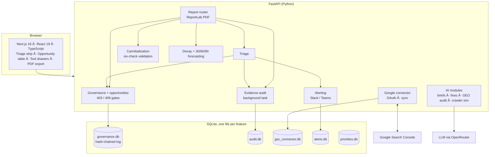

# Enterprise B2B SEO Intelligence & Data Governance Engine

**Prioritise search work, validate it, and sign it off, with every number honest about its limits and every decision on record.**

A FastAPI + Next.js (TypeScript) platform that sits between your search data and the actions taken on it. It is built to remove three costly problems in enterprise SEO:

| Problem | How the platform addresses it |
|---|---|
| **Keyword cannibalization** flagged by tools that cry wolf | Every candidate runs six validation checks (volume floor, canonical, regional/audience variants, country and same-day overlap, page type and intent, SERP domination) and lands in one of three verdicts, with the evidence shown |
| **Audit overhead**: days of exporting and reconciling before anyone can decide | Triage strip, automatic freshness and consistency audit, and a one-click executive PDF built from live data |
| **Unvalidated AI-generated content** | "AI drafts, humans decide": briefs and downstream work are refused by the **server** until a named reviewer approves, and every decision goes to a tamper-evident log |

> **Principle: no false precision.** Scores and projections are ranking aids to prioritise investigation and risk. They do not predict traffic, leads, or revenue. That sentence is shown on every scoring, forecasting and analysis view, and printed in the footer of every page of the PDF report.

---

## Contents

- [Architecture](#architecture)
- [Key modules](#key-modules)
- [Quick start](#quick-start)
- [Configuration](#configuration)
- [Operational commands](#operational-commands)
- [API overview](#api-overview)
- [Project structure](#project-structure)
- [Verification and limitations](#verification-and-limitations)
- [Roadmap](#roadmap)

---

## Architecture



**Design principles**

- **The server is the control.** Workflow locks in the UI are cosmetic; the API enforces them.
- **Fail visible.** A check that could not run shows as "degraded" or "Could not test", never as a green "all clear".
- **Provenance everywhere.** Each figure says where it came from and how old it is; first-party Search Console data is never blended with estimates or demo data.
- **Local and read-mostly where possible.** The triage endpoint makes no network calls, so it is cheap to poll and cannot fail because an external service is slow.

---

## Key modules

### 1. Server-enforced governance and append-only audit trail

- **Review states:** `Proposed → Approved | Needs changes | Rejected → Measuring → Completed`, each decision carrying a **named reviewer**, a verdict and a mandatory comment. The server sets the timestamp; clients cannot.
- **403 action gates:** generating a brief for an opportunity, locking a measurement baseline, and marking work complete are refused unless the opportunity is **Approved**. **409** once measurement starts: the verdict and the opportunity's content are frozen so the baseline stays valid.
- **Append-only log with hash chaining:** SQL triggers refuse any `UPDATE`/`DELETE` on the history, and every entry's SHA-256 hash covers the previous entry's hash. An edit or removal in the middle of the log breaks the chain, and `GET /api/v1/opportunities/audit-log/verify` detects it.
- **Honest limits:** the log is *tamper-evident*, not magically immutable. Reviewer names are self-declared (there are no user accounts yet), and deleting only the newest entries is undetectable without an external anchor. See [Verification and limitations](#verification-and-limitations).

### 2. False-precision guardrails

- The decay scenarios show a **low-to-high range band from 0.5× to 1.5× the fitted decay speed** around the "do nothing" path, with the day-90 high and low labelled. This is a **sensitivity band on the fitted trend, not a statistical confidence interval**; real outcomes can fall outside it. The "with refresh" line is a labelled scenario with no range of its own.
- The standard disclaimer appears on every forecasting, scoring and analysis view.
- Third-party or user-supplied estimates carry an **Estimated · Third-party** badge; sample data carries a **Sample data** badge; data-backed cards carry **Current / Stale / Missing** freshness chips with the last-sync date.

### 3. Six-check cannibalization engine

A query with two or more of your URLs is only a *candidate*. Before it is called harmful it runs:

| # | Check | Dismisses the candidate when… |
|---|---|---|
| 1 | **Low-volume floor** | the weakest competing URL (or the query) is under 20 impressions |
| 2 | **Canonical consistency** | Google already chose one canonical for all the URLs (and flags a declared canonical Google ignores) |
| 3 | **Regional and audience variants** | the URLs are locale or audience copies (`/en-gb/` vs `/en-us/`, `for-enterprise` vs `for-smb`) |
| 4 | **Country split, same-day overlap, flip-flopping** | different countries get different URLs, the URLs never overlap, or the lead flips back and forth (the last supports harm) |
| 5 | **Page type and intent** | the URLs are different page types serving different intents |
| 6 | **SERP domination** | two of your pages hold the top five, or one URL takes ≥ 80% of impressions at a top-five position |

Verdicts: **Harmful overlap**, **False positive**, **Cleared by validation checks**. Each finding opens a "Why, evidence and checks" panel showing every test, its threshold and what was observed. Checks that cannot be run with the stored data report **Could not test** (the canonical and country/day checks need an on-demand *deep check* against live Search Console data). The alert engine, triage strip and PDF report all count only harmful overlaps.

### 4. Executive PDF exporter

`GET /api/v1/reports/executive-audit-pdf` (or **Export Executive PDF** in the toolbar) builds a client-ready multi-page report with ReportLab:

- Cover and executive summary with the **Needs your attention** snapshot
- Business priorities and **30/60/90-day scenario chart** with the range band
- Technical audit: cannibalization findings after validation, data freshness, audit findings
- **Reviewer sign-off history** from the decision log, with the hash-chain verification result (optional)
- The disclaimer and `Page x of y` in the footer of **every** page. Reports built from sample data are tagged and watermarked **DEMO DATA** on every page so they cannot pass for real results.

Options: `prepared_for`, `prepared_by`, `notes`, `include_governance`, `source` (`auto` | `live` | `sample`).

### 5. Data provenance and freshness engine

A background audit (every 60 minutes by default, `EVIDENCE_AUDIT_MINUTES`) re-checks what the dashboard has stored and keeps the latest result in `audit.db`:

- **Stale data:** Search Console or crawl data older than 7 days.
- **Text-to-data variance:** alert text whose written figures differ from the current data by more than **25%**.
- **Integrity:** missing queries or positions, impossible values, row counts that do not match the sync record, and incomplete measurement baselines.

`GET /api/v1/audit/status` returns the findings, error counts and the time of the last run. A **Needs your attention** strip at the top of the dashboard rolls the seven most important signals into at most five prioritised items, each one click from where it is fixed.

### Also included

Search Console connector (OAuth, encrypted token storage) · alerting to Slack and Teams · content decay · GEO / LLM-citation audit · LLM crawler simulator · topic clusters · internal-link finder · AI content briefs, fix code and schema generators · live site inspector (Core Web Vitals via PageSpeed).

---

## Quick start

### Prerequisites

- **Python 3.10+** (developed on 3.15)
- **Node.js 20+** (developed on 24) and npm

### 1. Backend (FastAPI)

```bash
python -m venv .venv
# Windows:  .venv\Scripts\activate        macOS / Linux:  source .venv/bin/activate

pip install fastapi "uvicorn[standard]" pydantic requests cryptography pandas \
            python-dotenv openai python-multipart reportlab

uvicorn app:app --host 127.0.0.1 --port 8010 --reload
```

Open http://127.0.0.1:8010/docs for the interactive API reference. Developed against FastAPI 0.162, Pydantic 2.14, ReportLab 5.1.

> **Environment file.** Put your `.env` in the project root, next to `app.py`. It is located relative to the code, so it works wherever the project is cloned, and variables already set in your shell are respected. Without `OPENROUTER_API_KEY` the app still runs and prints a warning at start-up naming the path it looked in; AI features (briefs, fix code, rewrites) then fail with a clear error.

### 2. Frontend (Next.js)

```bash
cd seo-dashboard
npm install
npm run dev          # http://localhost:3000
```

The frontend talks to the API at `http://127.0.0.1:8010`. Override with `API_URL` (server-side requests) and `NEXT_PUBLIC_API_URL` (browser requests).

### 3. First run

With no Google credentials the dashboard runs entirely on **built-in sample data**, clearly labelled. To use your own data, set the Google OAuth variables below, click **Connect your live Google data**, choose a property and sync. The default redirect URI is `http://localhost:3000/gsc/callback`.

---

## Configuration

Set these in `.env` (project root) or your shell. **Never commit `.env` or `gsc_connector.key`** (both are in `.gitignore`).

| Variable | Used for | Required |
|---|---|---|
| `OPENROUTER_API_KEY` | AI briefs, fixes, rewrites (via OpenRouter) | For AI features |
| `GOOGLE_CLIENT_ID`, `GOOGLE_CLIENT_SECRET` | Search Console / GA4 sign-in | For live data |
| `GOOGLE_REDIRECT_URI` | OAuth redirect (default `http://localhost:3000/gsc/callback`) | No |
| `GSC_TOKEN_ENCRYPTION_KEY` | Fernet key for the stored Google token (otherwise a key file `gsc_connector.key` is generated) | No |
| `GSC_REFRESH_TOKEN_TTL_DAYS` | Set to `7` if your OAuth app is in "Testing" mode, to warn before sign-in lapses | No |
| `PAGESPEED_API_KEY` | Higher PageSpeed Insights quota | No |
| `EVIDENCE_AUDIT_MINUTES` | Background audit interval (default `60`, `0` = off) | No |
| `API_URL` / `NEXT_PUBLIC_API_URL` | Where the frontend finds the API | No |

---

## Operational commands

Run from the project root with `python scripts/<name>.py`, or from `seo-dashboard` with the npm shortcuts. Full details: [`scripts/README.md`](scripts/README.md).

| Command | What it does |
|---|---|
| `python scripts/pre_demo_check.py` | **Pre-flight diagnostic.** Prints PASS / WARN / FAIL for the environment, each database (integrity, tables, columns, decision-log hash chain), backup age, and the governance, triage, audit and PDF-export endpoints. Exit code 0 = ready. Add `--url http://127.0.0.1:8010 --frontend` to test the running servers. Read-only apart from storing a fresh audit run. (`npm run pre-demo`) |
| `python scripts/backup_database.py` | **Consistent backups.** Archives every SQLite database with SQLite's online-backup API into `backups/seo-dashboard-backup-<UTC time>.zip`, integrity-checks each copy, records **SHA-256** hashes and row counts in a manifest, and deletes archives older than 30 days. A failed run writes nothing and prunes nothing. `--dry-run`, `--list`, `--keep-days N`. (`npm run backup`) |
| `npm run build:guest` then `npm run start:guest` | Build and serve the web app for **guest sessions** on `127.0.0.1:3300`, with the browser calling the API on the same origin. This serves the app only; **the token-guarded read-only proxy is `npm run guest:tunnel`** (or `guest:serve` to bring your own tunnel). |
| `npm run guest:check` | Verifies the guest-access pieces and warns if anything is exposed on your network |
| `npm run guest:tunnel` | Starts the guard proxy plus a `cloudflared` or `ngrok` tunnel, **self-tests the public address** (26 access-control checks), and only then prints the one-time link |

**Guest access, in short.** The dashboard has no login, so never tunnel it directly. The guard proxy requires a secret token (swapped for an `HttpOnly` cookie and removed from the URL), allows **GET/HEAD only** (no writes, no AI spend), blocks setup routes (API docs, Google sign-in, alert webhooks), rate-limits and locks out brute force, binds to loopback, and expires automatically (default 2 hours). Session order: start the API on `127.0.0.1` → `npm run build:guest && npm run start:guest` → `npm run guest:check` → `npm run guest:tunnel`.

> Backups exclude `gsc_connector.key` (it decrypts the Google token in `gsc_connector.db`) and `.env`. Store the key separately, or reconnect Google after a restore. The `backups/` folder holds client data and is git-ignored.

---

## API overview

Interactive reference at `/docs` while the API runs. Core endpoints:

| Area | Endpoint |
|---|---|
| Governance | `GET /api/v1/opportunities` · `POST /api/v1/opportunities/{id}/decision` · `POST …/{id}/baseline` · `POST …/{id}/complete` · `GET …/{id}/history` · `GET /api/v1/opportunities/audit-log/verify` |
| Triage | `GET /api/v1/triage/attention-items` |
| Evidence audit | `GET /api/v1/audit/status` · `POST /api/v1/audit/run` |
| Cannibalization | `GET /api/v1/gsc/cannibalization` · `POST /analyze-cannibalization` · `POST /api/v1/cannibalization/deep-check` |
| Forecasting | `POST /api/v1/forecast/batch` |
| Executive PDF | `GET /api/v1/reports/executive-audit-pdf` |

---

## Project structure

```
b2b-accounts/
├── app.py                        # FastAPI app: routers, CORS, lifespan (background audit)
├── governance_store.py           # review state machine + append-only hash-chained log
├── opportunities_router.py       # opportunities, decisions, workflow gates
├── triage_router.py              # "Needs your attention" evaluators
├── evidence_audit_router.py      # freshness, text-vs-data and integrity audit (audit.db)
├── cannibalization_validation.py # the six validation checks + deep-check endpoint
├── forecasting_engine_router.py  # 30/60/90-day decay scenarios and range bands
├── report_router.py · report_pdf.py · report_demo_data.py   # executive PDF
├── gsc_connector_router.py       # Google OAuth, sync, encrypted token storage
├── alerting_engine_router.py     # volatility / split / crawler alerts, Slack & Teams
├── … (decay, GEO, crawler simulator, topic clusters, internal links, briefs, schema)
├── scripts/                      # backup_database.py · pre_demo_check.py · guest_access.py
├── docs/                         # ENTERPRISE_PITCH_DECK_AND_ROADMAP.md
└── seo-dashboard/                # Next.js 16 + React 19 + TypeScript + Tailwind 4 frontend
    └── app/                      # page.tsx, DashboardClient.tsx, panels, modals, Guardrails.tsx
```

---

## Verification and limitations

**Verified.** During development the governance gates and hash chain, triage, evidence audit, cannibalization validation, forecasting, report generation (including visual review of the rendered pages) and the operational scripts were exercised with roughly 550 automated checks, including negative controls that deliberately break a rule to confirm the tests fail. The frontend is checked with `npx tsc --noEmit` and `npx eslint .`.

**Be aware of these today:**

- **No user accounts or SSO.** Reviewer names are self-declared, so the log records *who said they decided*, not verified identity.
- **The decision log is tamper-evident, not absolutely immutable.** Deleting only the newest entries cannot be detected without an external anchor.
- **SQLite, single node.** Suitable for a pilot and demos; not for multi-tenant scale.
- **The automated test suites are not yet in this repository or in CI.**
- **Deep checks** (canonical and country/day) were tested with mocked Google responses, and **guest tunnelling** with a stand-in tunnel; neither has yet run against the live external services.
- **GA4 metrics are not stored**, so GA4 shows as "Missing" in freshness.
- **License:** not yet specified.

---

## Roadmap

The platform's decision layer (governance, provenance, validation, honest ranges, executive reporting) is designed to absorb a full SEMrush-class capability set. Each phase plugs into the same machinery:

| Phase | Capability | Summary |
|---|---|---|
| **P0** | Foundations | PostgreSQL, background workers, SSO and roles, CI with the test suites, provider abstraction |
| **P1** | **Deep site crawler** | Async multi-worker crawler: status codes, broken links, redirect chains, missing alt text, structured-data validation, Core Web Vitals (LCP, CLS, INP) from field and lab data |
| **P2** | **Competitor keyword gap** | Competitor rank tracking, shared vs missing keyword gaps, share of voice calibrated from your own CTR curve |
| **P3** | **Backlink toxicity** | Backlink profile model, explainable risk scoring, human-approved disavow file generation |
| **P4** | **AI search visibility** | Mention and citation tracking across ChatGPT, Perplexity, Gemini and Claude via official APIs, with sampling and confidence intervals |

Strategy: **build the decision layer, buy the data.** Third-party figures stay visibly labelled as estimates. Architecture, data models, formulas, effort estimates and risks are in [`docs/ENTERPRISE_PITCH_DECK_AND_ROADMAP.md`](docs/ENTERPRISE_PITCH_DECK_AND_ROADMAP.md), which also contains the pitch deck and a register of which claims are verified and which are hypotheses.
