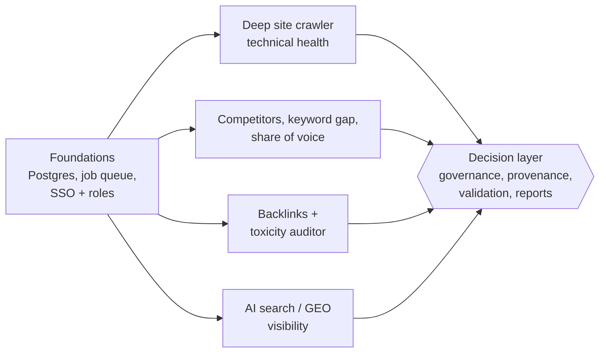
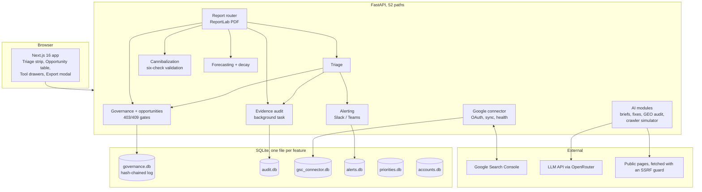
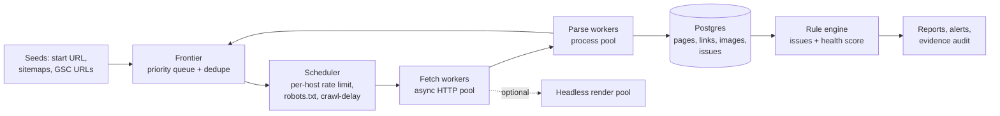
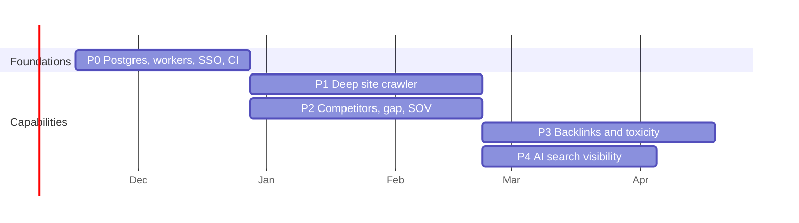

# SEO Decision Platform: Enterprise Pitch Deck & Expansion Architecture

**Version 1.0 · 27 October 2026 · Status: as-built review plus proposed roadmap**

> **How to use this document.** Part A is a 14-slide pitch deck: each `## Slide` is one slide (a headline, a few bullets, and speaker notes). Part B is the architecture and roadmap for expanding the platform. Part C is the evidence behind every claim. Convert Part A to slides with any Markdown-to-slides tool (for example `pandoc -t pptx`, Marp or Slidev). Diagrams are Mermaid and render on GitHub, GitLab and most Markdown viewers.
>
> **A note on honesty, because this goes in front of buyers.** Everything in "As built" is in the code today and was verified during development (see Part C). Everything marked **Hypothesis** or **Proposed** is not built or not measured, and is labelled that way on purpose: an enterprise buyer will test the numbers, and a deck that survives that test is worth more than one with bigger claims. The two largest claims in the original brief (an 80% audit-time reduction, and "CFO-defensible forecasting") are reframed in Part A, slides 9 and 10, and explained in Part C.

---

## Contents

**Part A: Pitch deck**
1. [Slide 1: Title](#slide-1--title)
2. [Slide 2: The problem](#slide-2--the-problem)
3. [Slide 3: The idea: AI drafts, humans decide](#slide-3--the-idea-ai-drafts-humans-decide)
4. [Slide 4: Platform at a glance](#slide-4--platform-at-a-glance-as-built)
5. [Slide 5: Governance you can audit](#slide-5--governance-you-can-audit)
6. [Slide 6: Honest numbers (false-precision guardrails)](#slide-6--honest-numbers-false-precision-guardrails)
7. [Slide 7: Know what needs you, and whether to trust the data](#slide-7--know-what-needs-you-and-whether-to-trust-the-data)
8. [Slide 8: Cannibalization that does not cry wolf](#slide-8--cannibalization-that-does-not-cry-wolf)
9. [Slide 9: Business value](#slide-9--business-value)
10. [Slide 10: ROI model](#slide-10--roi-model-validate-in-a-pilot)
11. [Slide 11: Operating it safely](#slide-11--operating-it-safely)
12. [Slide 12: Roadmap to a full suite](#slide-12--roadmap-to-a-full-suite)
13. [Slide 13: Build the decision layer, buy the data](#slide-13--build-the-decision-layer-buy-the-data)
14. [Slide 14: The ask](#slide-14--the-ask)

**Part B: Architecture and expansion**
[B1 As-built architecture](#b1-as-built-architecture) · [B2 Platform foundations](#b2-platform-foundations-before-scaling) · [B3 Competitor tracking, keyword gap, share of voice](#b3-competitor-tracking--keyword-gap-engine) · [B4 Backlink intelligence and toxicity](#b4-backlink-intelligence--toxicity-auditor) · [B5 Deep site crawler](#b5-deep-site-crawler--technical-health) · [B6 AI search / GEO visibility](#b6-ai-search--geo-visibility-engine) · [B7 Phasing, cost, risks](#b7-phasing-effort-and-risks)

**Part C: Evidence**
[C1 Claims register](#c1-claims-register) · [C2 Known limitations](#c2-known-limitations-today) · [C3 Glossary](#c3-glossary)

---

# Part A: Pitch deck

## Slide 1 · Title

# SEO Decision Platform
### Prioritise, validate and sign off search work, with every number honest and every decision on record.

- For: Heads of SEO / Digital, CMOs, and the finance and risk reviewers who sign off the spend
- Built on your own Search Console data, with a human decision step before anything ships

**Speaker notes.** Open with the one-sentence promise. The product is not "another rank tracker". It is the decision layer between data and action: what to look at first, whether the data can be trusted, and who approved what.

---

## Slide 2 · The problem

**Search teams are drowning in signals and short on defensible decisions.**

- A quarterly SEO audit is mostly assembly: exporting, reconciling and re-checking numbers before anyone can decide anything.
- Tools flag "cannibalization" and "decay" constantly. Many flags are false alarms (regional page variants, a canonical already consolidating two URLs, one page owning the top results).
- Leadership asks, "Can we trust this number, and who approved the plan?" Most teams cannot answer from the tool.
- AI-generated content and briefs arrive faster than anyone reviews them.
- Dashboards show projections as if they were facts, then lose credibility when reality differs.

**Speaker notes.** The pain is not a lack of data. It is the cost of turning data into a decision someone will stand behind, and the credibility hit when a precise-looking number turns out wrong.

---

## Slide 3 · The idea: AI drafts, humans decide

**Three principles run through every screen.**

1. **AI drafts, humans decide.** Briefs, fixes and plans are drafts. Nothing downstream unlocks until a named reviewer approves, and the server enforces it.
2. **No false precision.** Scores and projections are ranking aids. They carry ranges and a standard disclaimer. They do not claim to predict traffic, leads or revenue.
3. **Show your evidence.** Every number says where it came from and how old it is. Stale or inconsistent data is flagged before it reaches a slide.

**Speaker notes.** These three are the differentiators. Competitors can match features; matching a governance and honesty posture requires rebuilding how their product works.

---

## Slide 4 · Platform at a glance (as built)

| Pillar | What it does | Status |
|---|---|---|
| **Governance & review** | Reviewer sign-off, server-enforced workflow gates, append-only hash-chained decision log | Built, tested |
| **Honest numbers** | Range bands, standard disclaimer, third-party vs first-party badges, freshness chips | Built, tested |
| **Executive triage** | One strip: the five things that need a person now, each one click from the fix | Built, tested |
| **Provenance & freshness audit** | Stale-data, text-vs-data and integrity checks, stored and re-run automatically | Built, tested |
| **Cannibalization engine** | Six validation checks, three verdicts, evidence panel per finding | Built, tested |
| **Executive PDF** | Client-ready multi-page report with demo-data safeguards | Built, tested |
| **Operational tooling** | Consistent backups, pre-demo check, read-only guest access | Built, tested |
| **Analysis modules** | Search Console connector, alerting (Slack/Teams), content decay, 30/60/90-day scenarios, GEO audit, LLM-crawler simulator, topic clusters, internal links, briefs, schema, fix code | Built |

Scale of the build today: **52 API paths (56 operations), 27 backend modules (about 7,700 lines), 37 UI components.**

**Speaker notes.** Everything on this slide can be demoed live. Pillars 1 to 7 are the differentiating layer; the last row is the analysis breadth that feeds it.

---

## Slide 5 · Governance you can audit

**Every decision is on the record, and the server, not the screen, enforces the rules.**

- **Review states:** Proposed → Approved / Needs changes / Rejected → Measuring → Completed.
- **Workflow gates (HTTP 403):** generating a brief for an opportunity, locking a measurement baseline and marking work complete are refused by the server unless the opportunity is Approved by a named reviewer. Hiding a button is not the control; the API is.
- **Closed reviews (HTTP 409):** once measurement starts, the verdict and the opportunity's content are frozen so the baseline stays valid.
- **Append-only decision log:** database triggers refuse any update or delete, and a SHA-256 hash chain links every entry, so an edit or removal in the middle of the log is detected. One call verifies the whole chain.
- **Every comment, decision, status change, baseline lock and brief generation is logged** with a server-set timestamp. Clients cannot set the time.

**Honest limits (say them before they are asked):** reviewer names are typed in, because the platform has no user accounts yet, so the log proves *who said they decided*, not verified identity. Deleting the *most recent* entries cannot be detected without an external anchor. Both are closed by the SSO and anchoring work in B2.

**Speaker notes.** "Immutable" is the word buyers use. We say "tamper-evident, append-only", which is accurate and survives a security review.

---

## Slide 6 · Honest numbers (false-precision guardrails)

**The product refuses to oversell its own numbers.**

- Every scoring, forecasting and analysis view carries the standard line: *"Scores and projections are ranking aids to prioritize investigation and risk. They do not predict traffic, leads, or revenue."* It is also printed in the footer of every page of the PDF report.
- **Range bands, not single lines.** The decay scenario shows a low-to-high band from **0.5× to 1.5× the fitted decay speed** around the "do nothing" path, with the day-90 high and low labelled on the chart. The "with refresh" line is explicitly a scenario with no range of its own.
- **Provenance badges.** Third-party or user-supplied estimates (competitor pages, keyword volumes) are tagged *Estimated · Third-party* and never blended with first-party Search Console figures.
- **Freshness chips** on every data-backed card: *Current*, *Stale* or *Missing*, with the last-sync date.
- **Demo data cannot masquerade as results:** reports built from sample data are watermarked and tagged DEMO DATA on every page.

**Speaker notes.** The range is a sensitivity band on the decay speed, not a statistical confidence interval, and the document says so. That precision is the point.

---

## Slide 7 · Know what needs you, and whether to trust the data

**"Needs your attention": the top of the dashboard answers one question.**

- At most **five** prioritised items, colour-coded Critical / Warning / Action needed, each with one button to the place it is fixed.
- Seven triggers: Google sign-in problems, failed or partial syncs, crawlers being refused (HTTP 403/503), high-scoring opportunities waiting for sign-off, queries that split traffic, stale evidence (over 7 days), and inconsistencies found by the evidence audit.
- Nothing to do? A green "Nothing needs a decision". If a check could not run, it says so instead of showing green.

**Evidence audit (stored in `audit.db`, re-run automatically):**
- **Stale data:** Search Console or crawl data older than 7 days.
- **Text vs data:** alert text whose written figures differ from the current data by more than 25%.
- **Integrity:** missing queries or positions, row counts that do not match the sync record, incomplete measurement baselines.

**Speaker notes.** This is what stops a stale or inconsistent number from reaching an executive. It runs unattended on a schedule and is exposed at `GET /api/v1/audit/status`.

---

## Slide 8 · Cannibalization that does not cry wolf

**Two URLs on one query is a candidate, not a verdict.** Each candidate runs six checks:

1. **Volume floor:** under 20 impressions is set aside.
2. **Canonical consistency:** declared canonical vs the one Google chose.
3. **Regional and audience variants:** `/en-gb/` vs `/en-us/`, `for-enterprise` vs `for-smb`.
4. **Country split and same-day overlap:** different countries served by different URLs, URLs that never overlap, or a lead that flip-flops.
5. **Page type and intent:** a guide and a product page are not substitutes.
6. **SERP domination:** two of your pages in the top five is a win, not a problem.

**Three verdicts:** *Harmful overlap* · *False positive* · *Cleared by validation checks*. Each finding has a "Why, evidence and checks" panel showing every test, its threshold, and what was observed. Checks that cannot be run with the stored data say **"Could not test"** rather than guessing.

**Speaker notes.** The false-positive filter is the value. A tool that flags everything trains people to ignore it. The sixth check (domination) is what lets the UI separate "winning" from "harmful".

---

## Slide 9 · Business value

**What the platform changes, in terms a buyer can verify.**

| Outcome | How the platform delivers it | Confidence |
|---|---|---|
| **Less time assembling audits** | Executive report built in seconds (about 0.3 s measured), triage and freshness computed automatically | Mechanism proven; size of saving is a **Hypothesis**, see slide 10 |
| **Fewer wasted fixes** | Six-check validation removes false-positive cannibalization work before anyone acts | Mechanism proven; savings depend on your false-positive rate |
| **Lower brand and content risk** | AI output cannot proceed without a named human approval; every approval is logged | Control proven. It *reduces* the risk of unreviewed content; it cannot *eliminate* search-engine penalty risk |
| **Audit readiness** | Tamper-evident decision log with one-call verification, reviewer comments preserved | Proven for the log; identity assurance needs SSO (B2) |
| **Finance-reviewable forecasting** | Scenarios show their assumptions, ranges and explicit non-prediction disclaimer | Proven. Deliberately *not* a revenue forecast |

**Speaker notes.** Resist the temptation to say "eliminates". The product reduces specific, named risks and makes the remainder visible. That is the credible position with a risk or finance reviewer in the room.

---

## Slide 10 · ROI model (validate in a pilot)

**A model your finance team can fill in, with our target as a hypothesis to test.**

```
Annual value  =  (A × H × R)                 audit assembly time saved
              +  (F × W × C)                 wasted remediation avoided
              +  (G × E)                     governance / audit-prep time avoided
Annual cost   =  licence + data providers + hosting + onboarding

A = audits or reports per year      H = analyst hours per audit today (measure it)
R = share of H the platform removes F = false-positive fixes per year (count them)
W = hours per wasted fix            C = loaded cost per hour
G = audit/review requests per year  E = hours saved per request
```

- **Target hypothesis (not yet measured):** assembly time falls by roughly **80%** (from days to under 15 minutes of analyst time per executive report). The platform assembles the report in seconds; the human minutes are review and commentary.
- **How to validate in a 4-week pilot:** time-and-motion on the customer's current audit for one site; run the platform on the same site; compare analyst hours, count false positives removed, and record every number with its source. The pilot output replaces the target.
- **Illustrative only** (invented inputs, not a claim): 12 reports a year at 24 hours each, with 70% removed, is about 200 hours. At a loaded 80 per hour that is about 16,000 a year from this line alone.

**Speaker notes.** Lead with the formula and the pilot, not the percentage. If asked "where does 80% come from?", the honest answer is "it is our target; here is how we prove it on your data in four weeks."

---

## Slide 11 · Operating it safely

**Built to be run, handed over and demoed without drama.**

- **Backups:** one command archives every SQLite database with SQLite's online-backup API (consistent while the system is live), verifies each copy, keeps 30 days, and prunes only after a fully successful run.
- **Pre-demo check:** a PASS / WARN / FAIL report across environment, database integrity and schema, decision-log hash chain, backup age, and every critical endpoint, including the PDF export. Exit code tells a script whether it is safe to present.
- **Guest access for stakeholders:** a guard proxy in front of the app: secret one-time link, **read-only** (no writes, no AI spend), blocks setup routes, rate-limited with brute-force lockout, loopback-only, auto-expiring. A 26-check self-test runs against the *public* address before the link is ever shown.
- **Executive PDF:** cover, summary and triage, priorities with 30/60/90-day scenarios and range bands, technical findings, and reviewer sign-off history. The disclaimer is on every page.

**Speaker notes.** The guest proxy exists because the app has no login: tunnelling it directly would expose write endpoints. This is the kind of detail that earns trust with a security reviewer.

---

## Slide 12 · Roadmap to a full suite

**From decision layer to a SEMrush-class capability set (breadth, not index size).**



| Phase | Capability | Indicative effort* |
|---|---|---|
| P0 | Foundations: Postgres, background workers, SSO/roles, CI, provider abstraction | 4 to 6 weeks |
| P1 | Deep site crawler and technical health | 6 to 8 weeks |
| P2 | Competitor tracking, keyword gap, share of voice | 6 to 8 weeks |
| P3 | Backlink intelligence and toxicity auditor | 6 to 8 weeks |
| P4 | AI search / GEO visibility tracking | 4 to 6 weeks |

\*Planning estimates for 2 to 3 engineers, to be refined after discovery. P1 to P4 can overlap once P0 lands.

**Speaker notes.** Every new capability plugs into the same governance, provenance and guardrail machinery. That reuse is why the roadmap is credible and why each phase is shorter than a from-scratch build.

---

## Slide 13 · Build the decision layer, buy the data

**We do not out-crawl the internet. We make third-party data safe to decide on.**

- Large indexes (billions of keywords and backlinks) are a data business. Replicating them is not the strategy.
- **Integrate providers behind one interface** (for example Semrush, DataForSEO, Moz, Majestic, SERP APIs, CrUX) and tag every provider figure *Estimated · Third-party*.
- **Where we are unique:** validation (false-positive filtering), provenance and freshness, human sign-off, tamper-evident history, honest ranges, and executive reporting.
- **Own-data advantage:** Search Console gives first-party truth for your own site, which third-party estimates cannot match. The platform keeps them visibly separate.

**Speaker notes.** This answers "can you replace Semrush?" honestly: no, and you do not need to. You need the layer Semrush does not provide.

---

## Slide 14 · The ask

1. **A 4-week pilot** on one site: baseline the current audit effort, run the platform in parallel, produce a measured ROI.
2. **Decide the first expansion capability** from the roadmap (crawler, competitor/gap/SOV, backlinks or AI visibility) based on the pilot's biggest gap.
3. **Approve the foundations work (P0)**: SSO, Postgres and background workers. These unlock multi-user use and everything after.

**Speaker notes.** Close on a small, measurable step. The pilot turns every "hypothesis" label in this deck into a number.

---

# Part B: Architecture and expansion

## B1 As-built architecture



**Design patterns worth naming in a technical review**

| Pattern | Where | Why it matters |
|---|---|---|
| Server-side enforcement | Governance gates (403 / 409) | UI locks are cosmetic; the API is the control |
| Append-only + hash chain | `governance_history` | Tamper-evident log: SQL triggers refuse UPDATE/DELETE, SHA-256 chain detects mid-log edits |
| Evidence-first | `audit.db`, freshness chips | Every number carries source and age |
| Tri-state checks | Validation engine | "Could not test" is a first-class result, never a silent pass |
| Read-mostly, local | Triage endpoint | No network calls: cheap to poll, cannot fail because Google is slow |
| Fail visible | Triage, audit, strip | A broken check shows as "degraded", never as "all clear" |
| Provider-honest labelling | Badges | First-party vs estimated third-party never conflated |

**Verification to date.** About 550 automated checks were run during development across governance, triage, evidence audit, cannibalization validation, forecasting, priorities, report generation and the operational scripts, including negative controls (deliberately breaking a rule to confirm tests fail). These suites live in a development scratch area, not the repository, which is why moving them into the repo and CI is in P0.

---

## B2 Platform foundations (before scaling)

The current design (SQLite file per feature, single process, no accounts) is deliberate for a fast, safe first version. The expansion needs these first.

| Foundation | Today | Target | Why |
|---|---|---|---|
| **Datastore** | SQLite, one file per feature | PostgreSQL (partitioned time-series tables for SERP/crawl/backlink snapshots) | Concurrent writers, volume, backups, row-level security |
| **Background work** | One in-process audit loop | Job queue and workers (Postgres `SKIP LOCKED` to start, Redis/Celery or Arq later) | Crawls, SERP pulls and LLM sampling are long-running and rate-limited |
| **Identity** | Reviewer names typed in; no login | OIDC/SAML SSO, roles (viewer, analyst, approver, admin), per-site permissions | Makes the decision log's actor field verifiable |
| **Log anchoring** | Hash chain verifies mid-log edits | Periodically publish the chain head to an external store (object-lock bucket or notarisation service) | Detects deletion of the newest entries |
| **Multi-tenancy** | Single site context | Tenant ID on every table; per-tenant encryption keys for credentials | Agencies and multi-brand enterprises |
| **Provider abstraction** | Google only | `DataProvider` interface: `fetch()`, `cost()`, `quota()`, `provenance()` | Swap or combine vendors; central credit budget and caching |
| **Secrets** | Local key file and `.env` | Secret manager (KMS) with rotation | Enterprise security review |
| **Observability and CI** | Console logs; tests outside the repo | Structured logs, metrics, tracing; test suites and migration checks in CI | Operability and regression safety |
| **API hardening** | CORS allow-list | AuthN/Z on every route, rate limits, audit logging of reads | Required once multi-user |

**Provider interface sketch**

```python
class DataProvider(Protocol):
    name: str                                   # "dataforseo", "semrush", "gsc", ...
    provenance: Literal["first_party", "third_party_estimate"]
    def quote(self, request) -> Cost: ...       # cost estimate BEFORE any paid call
    def fetch(self, request) -> Result: ...     # returns data + as_of + request_id
    def quota_remaining(self) -> int: ...
```

Every `Result` is stored with `provider`, `as_of`, `request_id` and `provenance`, so the existing badge, freshness and audit machinery works for new data with no extra UI work.

---

## B3 Competitor tracking & keyword gap engine

**Goal.** Track how named competitors rank for a chosen keyword set over time, find where they win and we do not, and quantify share of voice (SOV).

### Data sources (build vs buy)

| Need | Source | Note |
|---|---|---|
| Your own rankings | Search Console (already integrated) | First-party, authoritative |
| Competitor rankings | SERP data provider API (scheduled SERP checks) | Third-party; tag *Estimated · Third-party* |
| Search volume, difficulty | Provider keyword database | Estimates; show `as_of` |
| SERP features | Provider SERP payload | Needed for CTR adjustment |

### Data model

```sql
tracked_keywords (id, site_id, keyword, locale, device, intent, group_id, added_by, added_at)
competitors      (id, site_id, domain, label, added_by, added_at)
serp_snapshots   (id, keyword_id, captured_at, provider, request_id,   -- partitioned by month
                  rank, domain, url, title, features_json)            -- one row per result position (top 100)
keyword_metrics  (keyword_id, provider, volume, difficulty, cpc, as_of)
sov_daily        (site_id, domain, date, sov_value, keywords_counted, ctr_curve_version)
gap_findings     (id, site_id, keyword_id, competitor_id, gap_type,    -- missing | weak | shared | unique
                  our_rank, their_rank, volume, opportunity_score, status, created_at)
```

### Pipelines

1. **Capture (scheduled worker).** For each tracked keyword × locale × device, pull the SERP at the configured cadence (daily for priority terms, weekly for the rest). Store one row per ranking result. Deduplicate by `request_id`. Budget-guard against the provider quota using `quote()` first.
2. **Normalise.** Canonicalise URLs and map results to your domain and competitor domains.
3. **Compute.** Rank deltas, entries and exits, volatility per keyword, SOV, and gaps.
4. **Alert.** Feed rank-movement events into the existing alert engine as new fingerprints (for example `rank:competitor:<domain>:<keyword>`) with thresholds and Slack/Teams delivery already built.

### Keyword gap logic

For each competitor *c* and tracked keyword *k*, with `top_n` configurable (default 20):

| Gap type | Rule |
|---|---|
| **Missing** | *c* ranks in the top `top_n` and we do not rank within `top_n` |
| **Weak** | both rank, and *c* outranks us by at least `m` positions |
| **Shared** | both rank within `top_n` and the gap is under `m` |
| **Unique** (our strength) | we rank within `top_n` and *c* does not |

`opportunity_score = volume_weight × rank_gap_weight × relevance × (1 / difficulty_penalty)`, with weights exposed in settings. It is a **ranking aid**, shown with the standard disclaimer, and feeds the existing 4-factor opportunity flow.

### Share of voice

For domain *d* over keyword set *K*, with `V_k` = monthly volume and `C(p)` = expected click-through rate at position *p*:

```
SOV(d)           = Σ_k V_k · C(p_dk)  /  Σ_k V_k · C(1)            "share of the available clicks"
SOV_relative(d)  = Σ_k V_k · C(p_dk)  /  Σ_{d' ∈ D} Σ_k V_k · C(p_d'k)   "share among tracked domains"
```

- **Calibrate `C(p)` from your own Search Console data** (clicks ÷ impressions by position bucket) rather than importing a generic curve. The synced rows already hold this; store the curve with a `ctr_curve_version` so history stays reproducible.
- Show SOV with a **range** (re-compute with the curve ±1 standard error and with and without SERP-feature adjustment) and the **disclaimer**: SOV is a visibility index, not predicted traffic.

### Governance and guardrails

- Competitor figures are **Estimated · Third-party** everywhere, never merged into first-party totals.
- Gap findings enter as **Proposed** opportunities. A named reviewer approves them before briefs are generated. The existing 403 gates apply unchanged.

### Reuse

Opportunity scoring, alert engine, governance, freshness chips, report builder (add a "Competitive position" section), topic clusters (group gap keywords into pillars).

---

## B4 Backlink intelligence & toxicity auditor

**Goal.** Track a site's backlink profile over time, surface risk, and produce a reviewed disavow file.

### Data sources (build vs buy)

| Need | Source | Limits |
|---|---|---|
| Your own links | Search Console Links report export; Bing Webmaster Tools | Own site only; partial |
| Competitor links, authority | Commercial backlink API (Moz, Majestic, Ahrefs, Semrush, DataForSEO) | Paid; each vendor's metrics differ |
| Free coarse graph | Common Crawl web graph | Periodic, host-level, not real-time |

### Data model

```sql
link_domains     (id, domain, first_seen, last_seen, provider_flags_json)
backlinks        (id, source_url, source_domain_id, target_url, target_site_id, anchor_text,
                  rel_flags,               -- nofollow | sponsored | ugc | follow
                  http_status, first_seen, last_seen, status,    -- live | lost | redirected
                  provider, as_of)
domain_metrics   (domain_id, provider, metric_name, value, as_of)   -- e.g. vendor "DR", "DA", "AS": kept per provider
anchor_profile   (site_id, as_of, branded_pct, exact_match_pct, partial_pct, generic_pct, naked_url_pct)
toxicity_assessments (id, backlink_id | domain_id, score, signals_json, model_version,
                      status,              -- proposed | reviewed_keep | reviewed_disavow
                      reviewed_by, reviewed_at, comment)
disavow_files    (id, site_id, version, created_at, created_by, content_hash, diff_from_prev)
```

### Authority indicators: no invented "domain authority"

Vendor authority scores are proprietary and not comparable. Store each as `(provider, metric_name, value, as_of)` and display it with its provider badge. If a single in-house indicator is wanted, compute an **internal link-graph score** (for example PageRank over the ingested graph) and label it exactly that.

### Toxicity: explainable heuristics, never auto-actioned

"Toxic" is a heuristic, not a fact Google publishes, and Google states that it generally ignores spammy links. So the auditor scores **risk with visible reasons**, and a human decides.

| Signal | Example evidence |
|---|---|
| Link-network footprint | Many linking domains on the same IP block / name servers / template |
| Anchor over-optimisation | Exact-match commercial anchors far above the profile norm |
| Sitewide / footer / widget links | Same link repeated across thousands of pages |
| Neighbourhood | Adult, gambling or pharma context; thin or auto-generated pages |
| Geographic or language mismatch | Unrelated TLD/language to your audience |
| Velocity spike | Sudden jump in new referring domains |
| Trust metrics | Very low vendor authority combined with other signals |
| Manual action | A manual-action notice in Search Console (hard escalation) |

`score = Σ w_i · s_i` with weights in settings and `signals_json` stored for every assessment, so each flag can be explained in one screen.

### Disavow generation (human-gated)

- Output follows Google's disavow format: UTF-8 text, `#` comment lines, `domain:example.com` for whole domains and full URLs for single pages; one entry per line; up to 100,000 lines and 2 MB.
- **Workflow:** assessments marked *reviewed_disavow* by an approver → generator builds the file → diff against the previous version → export. Google offers no disavow API, so the final upload is manual, and the tool says so.
- Each version is stored with a content hash and logged in the **append-only decision log** (who approved what, when, with their comment).
- Default posture in the UI: *"Disavow is rarely needed. Review the reasons before adding anything."* This protects users from the common mistake of over-disavowing.

### Reuse

Governance gates and log, alert engine (new-toxic-link and lost-link alerts), freshness audit (backlink snapshot age), report builder ("Link risk" section).

---

## B5 Deep site crawler & technical health

**Goal.** A first-party crawler that produces a full technical health picture, replacing the current single-URL inspector and crawler-access simulator with whole-site coverage.

### Architecture



### Specification

| Area | Spec |
|---|---|
| **Concurrency** | Async I/O for fetching (hundreds of in-flight requests, capped per host) plus a process pool for parsing, which avoids the GIL for HTML parsing. "Multi-threaded" is met by combining both. Design target 20 to 50 pages/s per politeness limits; **to be measured**, not promised |
| **Politeness** | Honour `robots.txt` (RFC 9309; the existing parser is reused) and `Crawl-delay`; identifiable user agent with contact URL; per-host token bucket; adaptive back-off on 429/5xx |
| **Safety** | Reuse the existing SSRF guard (public addresses only, redirect re-validation), size and time limits, no cookies, loop and trap detection (depth cap, URL pattern budget) |
| **Scope** | Same-site by default, configurable subdomains, include/exclude regexes, max pages (initial cap 100,000 per run), max depth |
| **Rendering** | Static HTML by default; optional headless-browser pool for JS-heavy sites, comparing raw vs rendered DOM (title, H1, links, canonical) to flag content that only exists after JavaScript |
| **Incremental** | Recrawl with `ETag` / `If-Modified-Since`; store content hash; only re-analyse changed pages |

### Data model

```sql
crawl_runs (id, site_id, started_at, finished_at, status, config_json, pages_crawled, pages_failed)
pages      (id, run_id, url, normalized_url, status_code, redirect_chain_json, content_type,
            response_ms, bytes, depth, title, meta_desc, h1_json, canonical, robots_meta,
            x_robots, lang, word_count, content_hash, inlinks, outlinks, rendered_diff_json)
links      (id, run_id, from_page_id, to_url, anchor, rel_flags, is_internal, target_status)
images     (id, run_id, page_id, src, alt_present, alt_text, bytes, status_code)
schema_items (id, run_id, page_id, format, type, valid, errors_json, warnings_json)
issues     (id, run_id, page_id, rule_id, severity, evidence_json, first_seen_run_id)
cwv_samples(id, url, origin, source, device, lcp_ms, cls, inp_ms, as_of, rating_json)
```

### Checks

| Category | Checks |
|---|---|
| **Status codes** | 4xx and 5xx pages; soft 404s (200 with "not found" content); redirect chains and loops; 302 that should be 301 |
| **Broken links** | Internal and external link targets (HEAD with GET fallback, cached per run, rate-limited for external hosts) |
| **Indexability** | `noindex` (meta and header), canonical missing / self-conflicting / pointing to non-200, pages blocked by robots yet linked |
| **On-page** | Missing or duplicate title / description / H1, thin content |
| **Images** | Missing `alt`, oversized images, broken image URLs |
| **Structure** | Orphan pages (compare crawl graph with sitemap and Search Console URLs), depth over 4 clicks, inlink concentration |
| **Structured data** | Parse JSON-LD, Microdata and RDFa; validate `@type` and required / recommended properties against the published rich-result requirements; report errors vs warnings |
| **Core Web Vitals** | See below |

### Core Web Vitals: field versus lab, stated plainly

- **Field data (what Google uses):** the Chrome UX Report (CrUX) API provides LCP, CLS and **INP** at page or origin level (75th percentile). Many URLs will have no field data; report "no data" rather than estimating.
- **Lab data:** PageSpeed Insights / Lighthouse for sampled URLs (rate-limited). **INP cannot be measured in the lab**; use Total Blocking Time only as a labelled proxy.
- **Thresholds** (Google's published "good" / "poor" boundaries): LCP ≤ 2.5 s / > 4 s; CLS ≤ 0.1 / > 0.25; INP ≤ 200 ms / > 500 ms. Store thresholds in config so a change is not a code release.
- Every CWV figure carries `source` (field or lab), `device` and `as_of`, and appears with the standard disclaimer. Lab numbers are never presented as field numbers.

### Health score

A weighted, transparent score (weights in settings, per-rule contribution visible). It is a **ranking aid** for triage, not a ranking prediction, and carries the disclaimer.

### Integration

- Crawl completion updates the **crawl** source in the freshness audit (today that source reflects only the alert engine's access check).
- Critical issues (for example a spike in 5xx, or key templates turning `noindex`) create **triage strip** items and Slack/Teams alerts.
- Findings become **Proposed** remediation items under the existing governance flow; the existing internal-link, schema and fix-code generators attach as "suggested fix drafts".

---

## B6 AI search / GEO visibility engine

**Goal.** Measure how often and how well AI answer engines mention and cite a brand, alongside classic SERP rankings, with honest uncertainty.

### Where the current product already helps

The **GEO audit**, **LLM-crawler simulator** and **GEO simulator** measure the *supply side*: can AI crawlers reach and read your pages, and how citable is the content. This engine adds the *demand side*: what AI engines actually say today.

### Engine access (compliance first)

| Engine | Access route | Note |
|---|---|---|
| ChatGPT / OpenAI | Official API with web-search tool (returns citations) | API answers are **not identical** to the consumer app; label results "API-sampled" |
| Perplexity | Sonar API (citations returned) | Close to the product behaviour |
| Gemini | Gemini API with Google Search grounding (returns grounding metadata) | Grounded-API behaviour differs from the consumer app |
| Claude | Anthropic API with web-search tool | Same API-vs-app caveat |
| Google AI Overviews / AI Mode | No official API. Use a SERP provider that captures AI Overviews, or manual capture | Third-party and estimated; badge accordingly |

Do **not** scrape consumer chat interfaces; it breaches terms of service and is unreliable. State the API-vs-app caveat in every report.

### Method

1. **Prompt library.** Tracked prompts grouped by intent (informational, comparison, "best X for Y"), persona and locale, seeded from Search Console queries and topic clusters, then reviewed by a human.
2. **Sampling.** LLM output is non-deterministic, so each prompt runs **n samples per engine per cycle** (for example 5 to 10) at a fixed temperature setting where the API allows. A single answer is an anecdote.
3. **Extraction.** For each answer, record whether the brand and each tracked competitor is **mentioned**, whether your domain is **cited**, the position of first mention, and the cited source domains.
4. **Qualitative scoring.** Sentiment / stance and factual accuracy against a brand fact sheet, using an LLM judge with a fixed rubric, plus a human spot-check sample (report the agreement rate).

### Metrics

| Metric | Definition |
|---|---|
| **Mention rate** | Answers naming the brand ÷ answers sampled |
| **Citation rate** | Answers citing your domain ÷ answers sampled |
| **AI share of voice** | Your mentions ÷ (your + tracked competitors' mentions), per engine and overall |
| **First-mention position** | Median rank of the brand in the answer's list of recommendations |
| **Accuracy flags** | Answers containing claims that contradict the fact sheet |
| **Source mix** | Which third-party domains the engines trust for your topic (a link-building and PR target list) |

**Uncertainty is part of the metric.** Report each rate with a **Wilson score interval** over the sample count, and show the interval. This is the same "range, not a point" principle as the decay bands. Do not report a change as real unless the intervals separate.

### Data model

```sql
geo_prompts  (id, site_id, text, intent, persona, locale, source, status, approved_by, created_at)
geo_runs     (id, prompt_id, engine, model_version, access_route, params_json,
              sample_no, captured_at, cost_usd, request_id)
geo_answers  (run_id, answer_text, citations_json, tokens)
geo_mentions (run_id, entity, entity_kind, first_position, cited, sentiment, accuracy_flag, judge_version)
geo_scores   (site_id, engine, date, prompts_counted, samples, mention_rate, mention_ci_low, mention_ci_high,
              citation_rate, ai_sov)
```

Raw answers are stored (and hashed) so a reported number can always be traced to what the engine actually said, using the same append-only discipline as the decision log.

### Cost control

`cost = prompts × engines × samples × runs_per_month × price_per_call`. Show the projected monthly cost **before** a schedule is enabled, enforce a hard budget cap per tenant, and degrade gracefully (fewer samples) when the cap nears.

### Closed loop

Low citation rate on a topic → "Proposed" opportunity (create or strengthen content, earn a mention on a cited source) → human approval → brief → remeasure with the same prompts. Visibility changes are shown with their intervals and the standard disclaimer; they are leading indicators, not revenue predictions.

---

## B7 Phasing, effort and risks

### Suggested order and dependencies



Indicative only; start dates depend on the pilot outcome and team size.

### Build versus buy summary

| Capability | Build in-house | Buy / integrate |
|---|---|---|
| Decision layer (governance, validation, provenance, reporting) | Yes (differentiator) | None |
| Crawler | Yes (needs first-party, site-specific control) | PageSpeed / CrUX for CWV |
| Keyword, SERP and competitor data | Scheduling, normalisation, gap and SOV logic | SERP / keyword data provider |
| Backlink data | Storage, scoring, disavow workflow | Backlink data provider |
| AI visibility | Prompt library, sampling, scoring, intervals | Engine APIs; optional SERP provider for AI Overviews |

### Top risks and mitigations

| Risk | Likelihood / impact | Mitigation |
|---|---|---|
| **Third-party data cost and terms** (SERP and backlink APIs are metered, and licences restrict redistribution) | High / High | `quote()` before paid calls, tenant budgets, caching, contract review before launch |
| **Provider metrics disagree** (each vendor's authority and volume differ) | High / Medium | Keep per-provider values, never average silently, badge every figure |
| **LLM answer variability** | High / Medium | n-sample design, Wilson intervals, "API-sampled" labelling |
| **Toxicity heuristics over-flag** | Medium / Medium | Explainable signals, human approval, "disavow is rarely needed" default |
| **Crawl load or legal exposure** | Low / High | robots.txt, rate limits, SSRF guard, per-site verification of ownership before deep crawls |
| **Scope creep into a data-index race** | Medium / High | Hold the line: integrate data, build the decision layer |
| **Single-node SQLite limits** | Certain at scale / Medium | P0 Postgres migration with a repository layer and migration tests first |

---

# Part C: Evidence

## C1 Claims register

What this document asserts, and how strong the support is. Use it to answer "how do you know?"

| Claim | Status | Evidence / note |
|---|---|---|
| Server returns 403 for brief, baseline and completion on unapproved opportunities; 409 once measurement starts | **Verified** | Automated checks on the governance module (reject paths, concurrency, timestamps set by the server) |
| Decision log is append-only and hash-chained; mid-log tampering is detected | **Verified** | Triggers refuse UPDATE/DELETE; tamper tests with triggers dropped detect the edit; chain verified by one endpoint |
| Log is "immutable" | **Reworded** | Accurate statement: *tamper-evident, append-only*. Deleting the newest entries is not detectable without external anchoring (B2) |
| Reviewer identity is verified | **Not true today** | Names are typed in; no accounts. SSO in B2 |
| Range band is 0.5× to 1.5× the fitted decay speed | **Verified** | Forecast engine and chart; documented as a sensitivity band, not a statistical confidence interval |
| Disclaimer text appears on every PDF page | **Verified** | Extracted text of every page checked in automated tests |
| Sample-data reports are marked DEMO DATA on every page | **Verified** | Cover, header tag and watermark; asserted per page in tests |
| Triage strip shows at most five items with seven triggers | **Verified** | Automated checks including the cap, ordering and degraded states |
| Evidence audit flags data older than 7 days and text-vs-data gaps above 25% | **Verified** | Boundary tests at exactly 25%, 50% and 7 days |
| Six-check cannibalization validation with three verdicts | **Verified** | Per-check boundary tests. Note: the sixth check (SERP domination) is an interpretation of the original brief's wording |
| Canonical and country/day checks work against Google | **Partly verified** | Logic tested with mocked responses; **not yet run against the live URL Inspection and Search Analytics APIs** |
| Backups are consistent, verified, retained 30 days, and never prune after a failed run | **Verified** | Scripts run against the real databases plus isolation tests (corrupt DB, concurrent writer) |
| Read-only guest access with token, lockout, expiry | **Verified locally** | 26-check self-test over HTTP; no write reaches the backend in tests. **Not yet run through a real cloudflared / ngrok tunnel** |
| Executive PDF builds a valid multi-page document | **Verified** | 6-page report; pages rendered and visually reviewed; 78 automated checks |
| **80% reduction in audit overhead, days to under 15 minutes** | **Hypothesis** | Report *assembly* takes seconds; analyst time saved is unmeasured. Validate in a pilot (slide 10) |
| **Elimination of cannibalization and AI-content penalty risk** | **Not claimed** | The platform reduces false-positive work and gates unreviewed AI output. It cannot guarantee that a search engine will not penalise content |
| **CFO-defensible growth forecasting** | **Reframed** | The product deliberately does *not* forecast revenue. It offers *finance-reviewable* scenarios with explicit assumptions and ranges. Selling it as a revenue forecast would contradict its own guardrail |

## C2 Known limitations today

- **No user accounts or SSO.** Reviewer names are self-declared; guest access is a stop-gap proxy.
- **SQLite, single node.** Fine for a pilot and demos; not for multi-tenant scale.
- **GA4 metrics are not stored.** Only the property selection is saved, so GA4 shows as "Missing" in freshness.
- **Cannibalization sample and demo data** live partly in the front end; a synced Search Console connection is needed for real results.
- **Deep checks and tunnelling** have been verified with mocks and a stand-in respectively, not against the live external services.
- **Test suites** exist but are not yet committed to the repository or run in CI.
- **Pitch-deck generator:** this document is the deck source. An automated slide-export feature is not built.

## C3 Glossary

| Term | Meaning |
|---|---|
| **Cannibalization** | Two or more of your URLs competing for the same query |
| **SOV (share of voice)** | Your share of the available clicks, or of the clicks among tracked domains, for a keyword set |
| **GEO** | Generative-engine optimisation: visibility in AI answer engines |
| **CrUX** | Chrome UX Report: real-user (field) performance data |
| **INP** | Interaction to Next Paint: the responsiveness vitals metric that replaced FID |
| **Wilson interval** | A confidence interval for a proportion that behaves well with small samples |
| **Disavow** | A file asking Google to ignore specified links; rarely needed |
| **Hash chain** | Each log entry's hash covers the previous entry's hash, so editing any earlier entry breaks every later one |
| **Ranking aid** | A number for ordering what to look at first; not a prediction of traffic, leads or revenue |

---

*This document describes software as built on 27 October 2026 and a proposed roadmap. Effort figures are planning estimates. Provider names are examples of data sources, not commitments or endorsements.*
